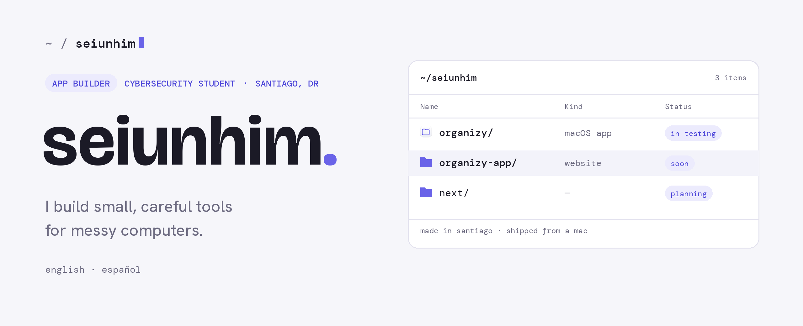

<picture>
  <source media="(prefers-color-scheme: dark)" srcset="assets/banner-dark.png">
  
</picture>

### `projects/`

| | | |
|---|---|---|
|  | **[Organizy](https://github.com/seiunhim/organizy-app)**<br><sub>Tidies any messy folder on your Mac. It reads each file, suggests where it belongs, and moves nothing until you confirm. Every move can be undone. Optional local AI with Ollama.</sub> | <sub>`macOS` `SwiftUI`<br>`free` `offline`</sub> |

### `now/`

```
building    Organizy 0.1, getting it ready for its first public release
studying    cybersecurity: networking, Linux, and penetration testing labs
learning    how to ship software people can trust with their files
```

### `stack/`

```
apps        Swift · SwiftUI · AppKit
web         HTML · CSS · JavaScript
scripts     Python · zsh
security    networking · Linux · virtualized labs
```

### `principles/`

```
review-first     Software that touches your files should show you the plan before it acts.
undo-always      Every change should be reversible.
local-by-default Your data stays on your machine unless you choose otherwise.
```

<sub>Hablo español e inglés. · Santiago, República Dominicana</sub>
