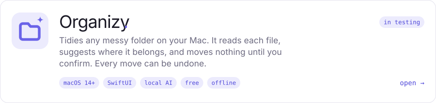
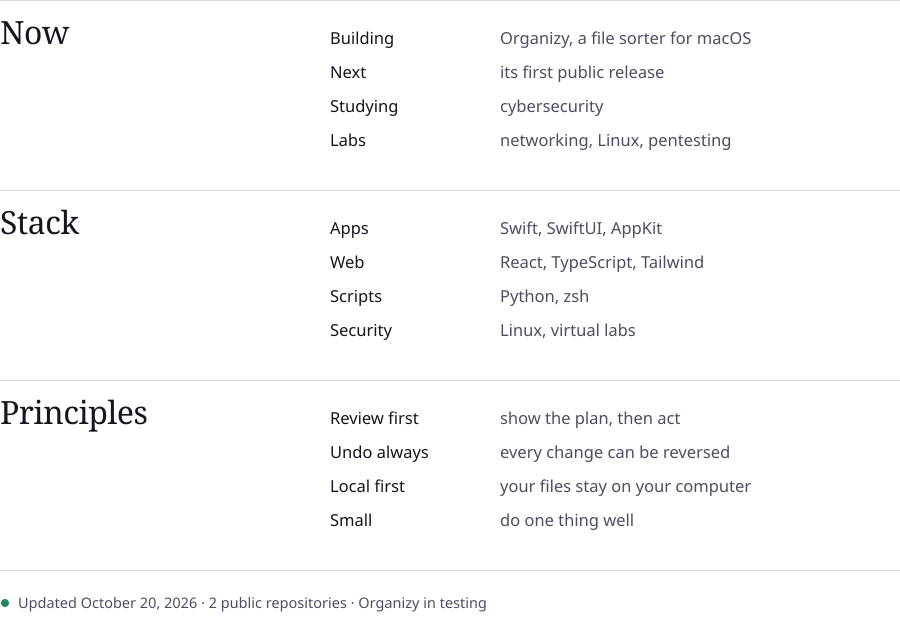

<picture>
  <source media="(prefers-color-scheme: dark)" srcset="assets/hero-dark.svg">
  
</picture>

 

<a href="https://koschei-dev.github.io/organizy-app/#demo">
  <picture>
    <source media="(prefers-color-scheme: dark)" srcset="assets/organizy-dark.svg">
    
  </picture>
</a>

Releases and issues: <a href="https://github.com/koschei-dev/organizy-app">koschei-dev/organizy-app</a>

 

<picture>
  <source media="(prefers-color-scheme: dark)" srcset="assets/panels-dark.svg">
  
</picture>

Images are generated by <a href="scripts/build.py"><code>scripts/build.py</code></a> and refreshed daily by a GitHub Action. Fonts: Bodoni Moda and Jost (SIL OFL), the same as on the Organizy website.
